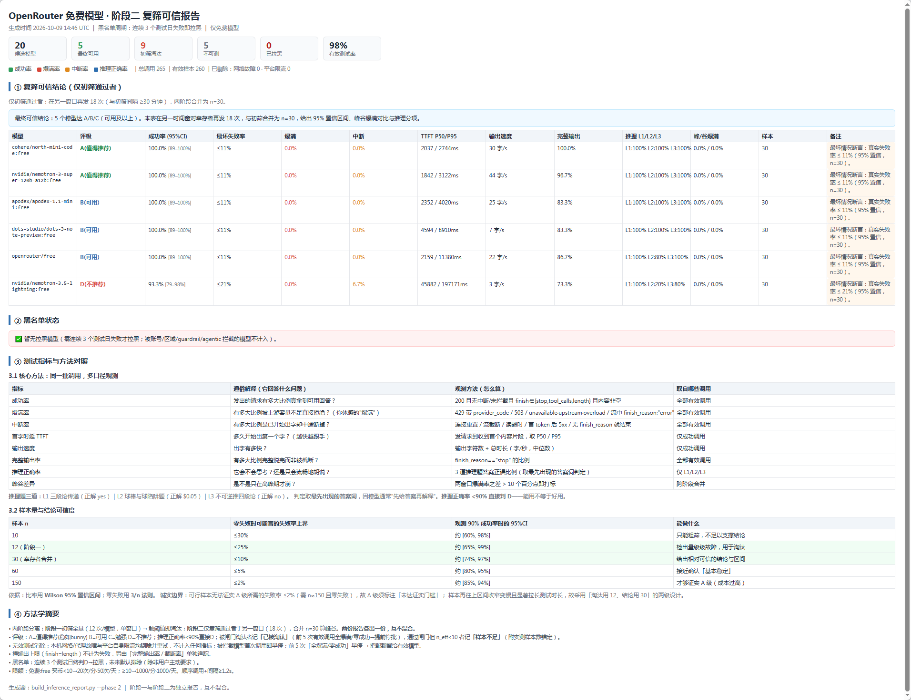
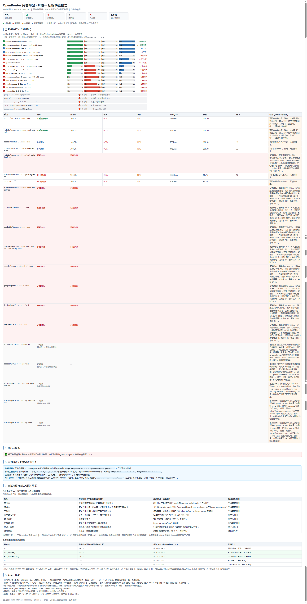
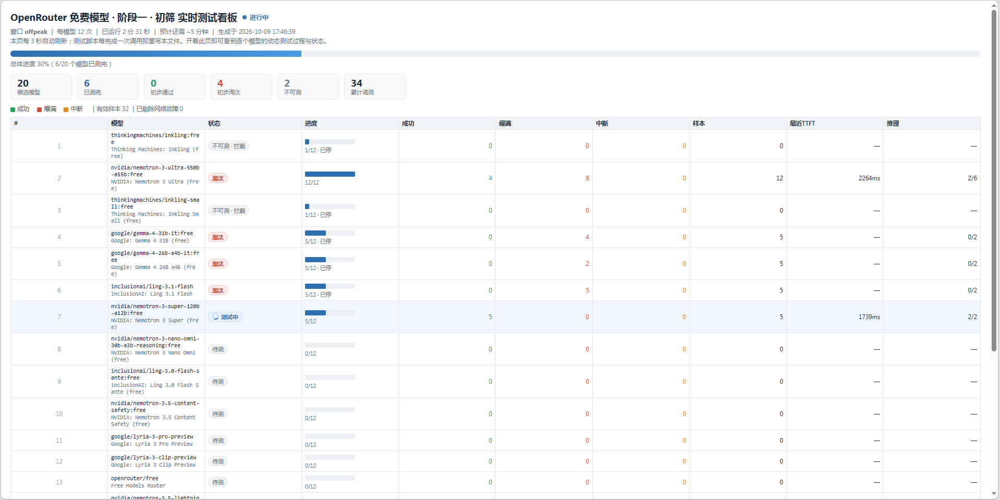
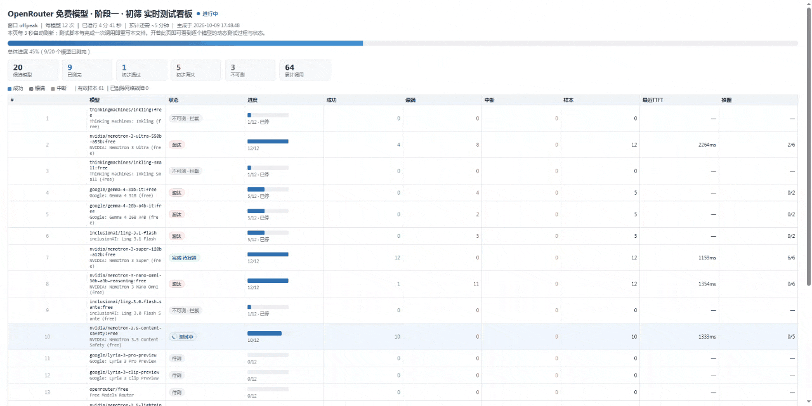

# OpenRouter 免费大模型筛选与推荐

> **在线率高 ≠ 真能用。** 这个技能专门解决免费大模型选型里最容易被骗的一件事——用真实推理探测，把「看着很稳、实际总崩」的模型筛出去。

一个 Agent Skill：从 OpenRouter 拉取全部 `:free` 模型，按四维分类 + 加权评分给出推荐，并用**两阶段真实推理测试**作为最终推荐闸门。



*上图为真实产出：20 个候选经两阶段实测后仅 5 个通过初筛、5 个可用、1 个不推荐，并标注峰值爆满风险。*

---

## 目录

- [30 秒快速开始](#30-秒快速开始)
- [它解决什么问题](#它解决什么问题)
- [适用 / 不适用](#适用--不适用)
- [场景映射](#场景映射)
- [能力一览](#能力一览)
- [实测验证](#实测验证)
- [怎么用](#怎么用)
- [产物说明](#产物说明)
- [方法与口径](#方法与口径)
- [结论的置信度](#结论的置信度)
- [测得准不准](#测得准不准)
- [FAQ](#faq)
- [许可与署名](#许可与署名)

---

## 30 秒快速开始

**前置条件**

| 项 | 要求 |
| --- | --- |
| Python | 3.8+，仅标准库（`urllib` / `concurrent.futures`），无需 pip 安装 |
| 网络 | 需访问 `openrouter.ai` |
| 密钥 | `OPENROUTER_API_KEY` 环境变量（**仅第七步真实推理测试需要**；只做分类推荐则无需。⚠️ 风险与隔离做法见 FAQ「关于密钥」） |

**安装**：把本仓库克隆到你的技能目录

```bash
git clone <仓库地址> ~/.workbuddy/skills/openrouter-free-model-scout
```

**直接说人话即可触发**（无需记命令）：

```
查一下 OpenRouter 现在有哪些免费大模型能用，推荐几个最值得用的
```

```
OpenRouter 上哪个免费推理模型最强？
```

```
帮我测一下 nvidia/nemotron-3-ultra-550b-a55b:free 这个免费模型稳不稳定
```

```
对比测试一下这几个免费模型的连接稳定性：xxx:free, yyy:free
```

> `xxx` / `yyy` 处填 OpenRouter 模型 ID（形如 `厂商/模型名:free`），ID 列表可从 `openrouter_free_report.html` 的全量排名表直接复制。

---

## 它解决什么问题

免费模型选型的常见做法是**看端点在线率排序，然后推荐前几名**。这个方法有一个致命缺陷：

| 信号 | 端点在线率能反映吗 | 真实推理探测能测到吗 |
| --- | --- | --- |
| 厂商宕机 | ✅ 能 | ✅ 能 |
| **高峰爆满（429 / 503）** | ❌ 几乎不能 | ✅ 直接测得 |
| **流中断 / 超时 / 截断** | ❌ 不能 | ✅ 直接测得 |
| 真实首字时延 TTFT | ❌ 免费层不发布 | ✅ 测得 |
| **输出是不是在瞎说** | ❌ 不能 | ✅ 三道逻辑题验证 |

实测反例就在公开目录里：`thinkingmachines/inkling:free` 端点在线率 ≈99.3%，实际经常爆满、中断；`nvidia/nemotron-3-ultra-550b-a55b:free` 在线率 ≈96.2%，同样不稳。

本技能的做法：**在线率降级为预筛指标，推荐结论必须由真实推理探测背书。**

---

## 适用 / 不适用

**适合**

- 要在 OpenRouter 上选 `:free` 模型做日常对话、写作、代码辅助
- 想验证某个具体免费模型「到底能不能用」
- 要给团队/项目定一个可长期依赖的免费模型

**为什么值得做**

免费模型最大的隐性成本是**不确定性**：一个模型可能连续跑一周毫无问题，然后在一次赶工的高峰期爆满中断——你无法预知是哪一次，也无法提前准备。真正消耗人的不是模型崩掉本身，而是**反复排查、反复换模型、反复重跑**。

这个技能把这件事变成一次性工作：**免去不稳定的免费模型，为你的工作/项目带来可控的选型依据，节省你大量的测试时间与测试工作。**

具体省下的是：

| 原本要做的 | 有了这个技能之后 |
| --- | --- |
| 逐个手动试模型，试到崩为止 | 一条命令批量测完所有候选 |
| 靠感觉判断「这个应该能用」 | 有成功率、爆满率、TTFT 与置信区间 |
| 出了问题再回头排查是哪个模型不稳 | 推荐前就已有实测数据，不稳的早被排除 |
| 高峰期突然崩，临时找替代 | 提前知道哪些模型峰值会慢、哪些会崩 |

**不适合**

- 非 OpenRouter 平台（Together、HuggingFace、硅基流动等）——本技能只取 OpenRouter 公开 API
- 付费模型的跨平台比价——只覆盖 `:free` 层
- 需要 SLA 保障的生产级选型——免费层无 SLA，本技能不承诺可用性
- 只想看排行榜、不打算跑测试——建议直接看 `openrouter_free_report.html` 的全量排名表
- 赶时间立刻要结果——两阶段全量扫描 20 个模型约需 90 分钟（慢模型在峰值窗口单轮可达 200 秒级），建议后台运行

---

## 场景映射

| 你想做的事 | 怎么说 | 会发生什么 |
| --- | --- | --- |
| 泛泛地要推荐 | 「OpenRouter 免费模型推荐」 | 跑六步管线，出 Top3 + 各维度冠军（无需密钥） |
| 只想看推理能力最强的 | 「哪个免费推理模型最强」 | 触发体量感知护栏，区分「整体最强」与「轻量定位第一」 |
| 验证单个模型 | 「测一下 xxx:free 稳不稳」 | 定向两阶段测试，只花该模型的配额 |
| 横向对比多个 | 「对比测试 xxx, yyy, zzz 的稳定性」 | 多模型同批测试，指标可直接横比 |
| 赶时间只看初筛 | 「快速筛一轮」 | 阶段一 12 次/模型，出快览报告 |
| 要能上生产的结论 | 「复筛并给置信区间」 | 阶段二 18 次/模型，合并 n=30，给 95% CI |

---

## 能力一览

| # | 能力 | 载体 |
| --- | --- | --- |
| 1 | 六步管线：抓取 → 过滤 → 增强 → 四维分类 → 加权评分 → 推荐 | `openrouter_free_models.py` |
| 2 | 四维分类：推理级别 / 模型能力 / 免费活动时间 / 免费热门度 | 同上 |
| 3 | 综合评分 + 免费稳定性乘子护栏 | 同上 |
| 4 | 「推理最强」体量感知护栏 + 未测模型封底 | 分类逻辑 |
| 5 | 两阶段真实推理测试（初筛淘汰 / 复筛定论），配额省着用 | `inference_stability_test.py` |
| 6 | 三道逻辑题验证「是否真会推理」 | `references/stability_test_standard.md` |
| 7 | 三份 HTML 产出（阶段一报告 / 阶段二报告 / 实时看板）+ Markdown + JSON | 3 个 build 脚本 |
| 8 | 推荐输出格式：Top3 表 + 维度冠军 + 口径透明披露 | 输出规范 |

**观测 12 项指标**

成功率、爆满率、中断率、超时率、首字时延（TTFT P50/P95）、总时延、输出速度、完整输出率、截断率、推理正确率、峰谷差异、样本量。

其中三条口径值得单说——混淆它们会得出错误结论：

| 指标对 | 关键区别 |
| --- | --- |
| **爆满 ≠ 中断** | 爆满＝还没开始就被容量拒绝；中断＝已经开始出字却中途断掉。两者是不同故障，混为一谈会误导判断 |
| **截断 ≠ 失败** | 撞 `max_tokens` 上限不影响可用性，只影响完整度，单独统计且不计入失败 |
| **推理正确率 < 90% 直接判 D** | 即便 100% 不爆满。「能用」不等于「好用」 |

---

## 实测验证

> 以下为 **2026-10-09** 的一次真实全量运行快照。免费模型变动频繁，**这是历史结果，不代表当前状态**，请以自己运行为准。

20 个候选，**260 个有效样本，有效测试率 98%**，全程零网络故障、零平台限流。

| 模型 | 评级 | 成功率 95%CI | 最坏失败率 | TTFT P50/P95 | 输出速度 | 推理 L1/L2/L3 | 峰/谷爆满 |
|---|---|---|---|---|---|---|---|
| `cohere/north-mini-code:free` | **A** | 100% [89–100%] | ≤11% | 2037 / 2744 ms | 30 字/s | 100/100/100% | 0% / 0% |
| `nvidia/nemotron-3-super-120b-a12b:free` | **A** | 100% [89–100%] | ≤11% | 1842 / 3122 ms | 44 字/s | 100/100/100% | 0% / 0% |
| `apodex/apodex-1.1-mini:free` | B | 100% [89–100%] | ≤11% | 2352 / 4020 ms | 25 字/s | 100/100/100% | 0% / 0% |
| `dots-studio/dots-3-note-preview:free` | B | 100% [89–100%] | ≤11% | 4594 / 8910 ms | 7 字/s | 100/100/100% | 0% / 0% |
| `openrouter/free` | B | 100% [89–100%] | ≤11% | 2159 / 11380 ms | 22 字/s | 100/80/100% | 0% / 0% |
| `nvidia/nemotron-3.5-lightning:free` | **D** | 93.3% [79–98%] | ≤21% | 45882 / **197171** ms | 3 字/s | 100/20/80% | 0% / 0% |

### 三条值得看的发现

**① 峰谷差异不在「拒不拒绝」，而在「等多久」。**
全部幸存者的峰/谷爆满率均为 0%，`peak_risk` 全为 False——这批模型的容量供给在取样窗口内未见收紧。但**峰值 TTFT P95 普遍上升 1.6–6.4 倍**。若只测「能不能用」而不测「等多久」，会漏掉真实的高峰体验损失。

**② 离峰就不合格的模型，峰值必然崩溃。**
`nemotron-3.5-lightning` 离峰时 TTFT P95 已达 30.8 秒，峰值飙至 197 秒、18 轮中 17 轮触发超时阈值、2 次中途中断、L2 推理正确率跌至 20%。它的问题在离峰就已暴露，只是当时被「100% 成功」掩盖了。

**③ 初筛评级会随峰谷改变，这是设计预期而非缺陷。**
`openrouter/free` 离峰初筛仅 83% 推理正确（判 D），峰值复筛升至 100%（判 B）；`nemotron-3-super` 离峰 A 级、峰值 TTFT 翻倍仍维持 A 级。**两阶段合并才是结论，单窗口结论会随风向摆动。**

---

## 怎么用

Agent 会自动按此流程执行，你也可以手动跑。

```bash
# 复制脚本到工作区（输出落在工作区，不污染技能目录）
cp ~/.workbuddy/skills/openrouter-free-model-scout/scripts/*.py ./

# 1) 分类推荐（无需密钥）
python openrouter_free_models.py
python build_report.py
# 断网或想复现旧口径时：
python openrouter_free_models.py --use-cache

# 2) 真实推理测试（需密钥；免费推理本身 $0，但要消耗调用配额）
export OPENROUTER_API_KEY=sk-or-...
# 阶段一 初筛：全部候选，12 次/模型，单窗口
python inference_stability_test.py --phase 1 --from-classified free_models_classified.json --rounds 12 --window offpeak
python build_inference_report.py --phase 1 inference_stability.json phase1_report.html

# 等 ≥30 分钟（建议 1 小时）再复筛，形成可辨峰谷
# 阶段二 复筛：仅初筛通过者，18 次/模型
python inference_stability_test.py --phase 2 --rounds2 18 --window peak
python build_inference_report.py --phase 2 inference_stability.json phase2_report.html
```

> ⚠️ **配额纪律**：OpenRouter 免费层有硬限额 —— **累计充值 ≥ $10** 才解锁 1000 次/天，否则只有 50 次/天（20 次/分，两档相同）。测试须顺序调用、间隔 ≥1s。
>
> ⚠️ **失败请求照样扣配额**：被限流或被拒绝的请求同样计入当日额度。若不先提升额度就全量扫描，很容易把自己的限流误判成「模型爆满」。

---

## 产物说明

### 阶段一 · 初筛快览



一屏内给出全部候选的一行结论：评级 / 成功率 / 爆满 / 中断 / TTFT / 推理 / 样本 / 备注。淘汰居中、不可测沉底。

### 阶段二 · 复筛可信结论


只展示幸存者，含两阶段合并样本 n、**95% 置信区间**、最坏情况失败率上界、峰谷对比、TTFT P50/P95、推理分项与最终评级。

### 实时看板（过程页）



拿到免费名单即生成框架，测试每完成一次调用即刷新（页面自带 3s 自动刷新）。逐模型显示状态、进度、成功/爆满/中断计数与最近 TTFT。



**文件清单**

| 文件 | 内容 |
| --- | --- |
| `free_models_classified.json` | 结构化分类数据（下游脚本输入） |
| `openrouter_free_report.html` | 可视化报告：工作流图 / 推荐卡 / 维度冠军 / 分布 / 全量排名 |
| `openrouter_free_report.md` | Markdown 摘要 |
| `openrouter_models_raw.json` | 原始模型列表缓存 |
| `inference_stability.json` | 逐模型两阶段明细 + 合并指标 + CI + 评级 + 峰谷风险 |
| `phase1_report.html` / `phase2_report.html` | 两阶段**各自独立**的结果报告（不合并出） |
| `phase1_live.html` | 实时测试看板（过程页，非结论） |

---

## 方法与口径

**四维分类**

| 维度 | 主口径 |
| --- | --- |
| 推理级别 | API `reasoning` 字段 + 模型族启发；强制 95 / 默认开启 78 / 可选 55 / 非推理 25 |
| 模型能力 | 上下文长度（对数刻度 8k→1M）+ 多模态广度 + 基准指数 + 工具调用支持 |
| 免费活动时间 | 永久 100 / 长期限免 80 / 短期 60 / 临期 <30天 35 / 已过期 5 |
| 免费热门度 | 提供方数量为主代理，叠加在线率与延迟 |

**综合评分**：推理 ×40% + 能力 ×35% + 热门 ×25%，再乘免费稳定性系数（永久 1.0 / 长期限免 0.95 / 短期 0.85 / 临期 0.6 / 过期 0.1）。

**两条护栏**

1. **体量感知** —— 「推理最强」只在实测模型中评选，优先非轻量变体；轻量定位的实测第一单独标注但不抢头衔。名字里带 flash / lite / mini 的一律排除是错的，那只是厂商命名。
2. **稳定性乘子** —— 免费稳定性是乘子而非评分项，避免临到期模型被优先推荐。

**已知口径局限**（报告中会披露）

- OpenRouter 公开 models API **不含使用量/调用量/热门度字段**，「免费热门度」只能以「提供方数量」作代理——托管越广通常越可靠，但不是直接的热度数据。

**评级口径**

| 等级 | 条件（全部满足） | 含义 |
| --- | --- | --- |
| **A 值得推荐** | 成功率 ≥98% · 爆满 ≤2% · 中断 ≤3% · TTFT P95 ≤15s · 输出有效 ≥95% · **推理正确 ≥90%** | 稳定且会推理 |
| **B 可用** | 成功率 ≥90% · 爆满 ≤8% · 中断 ≤8% · TTFT P95 ≤30s | 基本稳定 |
| **C 勉强** | 成功率 ≥75% · 爆满 ≤20% | 偶发爆满/中断 |
| **D 不推荐** | 成功率 <75% 或 爆满 >20% 或 频繁中断 或 推理正确 <50% | 不可用 |

> **诚实边界**：A 级的「失败率 ≤2%」需要 n≈150 且零失败才能统计证实。本技能采用「淘汰用 12、结论用 30」的两级设计，因此 **A 级一律标注「未达证实门槛」**——只可断言「真实失败率 ≤ 3/n」。报告始终显示 95% CI 与最坏情况上界，不只报点估计。

完整标准见 [`references/stability_test_standard.md`](references/stability_test_standard.md)。

---

## 结论的置信度

这是本技能与「跑一跑看看」类工具的**根本区别**——不报点估计，报区间与上界。

比率型指标在小样本下使用 **Wilson 95% 置信区间**；零失败时用 **3/n 法则**（n 次零失败 → 可断言真实失败率 ≤ 3/n，95% 置信）。

| 样本 n | 零失败时可断言失败率上界 | 能做什么 |
| --- | --- | --- |
| 10 | ≤ 30% | 只能粗筛，**不足以支撑结论** |
| **12（阶段一）** | ≤ 25% | 检出量级级故障，用于**淘汰** |
| **30（幸存者合并）** | ≤ 10% | 可给出**相对可信**的稳定性结论 |
| 150 | ≤ 2% | 才够**证实 A 级**，单模型成本过高 |

**诚实边界（明确写进报告，不回避）**

1. n=10 的区间宽达 38 个百分点，不具备独立支撑结论的可信度，故提升至 12 / 30。
2. 用可行样本**无法**证实 A 级所需的「失败率 ≤2%」——那需要 n≈150 且零失败。因此 **A 级一律标注「未达证实门槛」**，只可断言「真实失败率 ≤ 3/n」。
3. 样本不宜再高：n>60 后区间收窄变慢（边际收益递减），却显著拉长时长、增加被限流风险。
4. 报告必须显示 95% CI 与最坏情况失败率上界，不得只报点估计。

---

## 测得准不准

测试工具自身的故障会伪装成模型的故障。这一节是关于**如何避免自己骗自己**。

### 网络故障隔离

本机或代理故障（502 Bad Gateway、Tunnel connection failed、SSL UNEXPECTED_EOF、RemoteDisconnected）**不能算到模型头上**。这类故障被标记 `network`，自动重试 4 次（退避 1.5s），仍失败则从指标中**整体剔除**——不计入成功率/中断率、不进黑名单。

> 这个隔离不是理论设计。此前网络抖动曾把两个模型的峰值窗口结果污染成「不稳定」，实际是自己的网络在抖。

### 两种 429 必须区分

| 类型 | 判据 | 处置 |
| --- | --- | --- |
| 上游 provider **at capacity** | 429 带 `error.metadata.provider_code`，或 503 overloaded | **计入爆满率**（真实信号） |
| 平台**自身限流** | 429 无 `provider_code` | 退避重试，**不计入模型不稳定** |

流中限流以 SSE `finish_reason:"error"` 到达（已发 200），按爆满/中断处理。

### 不可测 ≠ 不稳定

账号/区域/护栏拦截的模型**无法判定稳定性**，故不计入任何指标、不进黑名单。首次调用即判定则**立即停止后续调用**（避免白跑满整批）。

| 类别 | 精简标签 | 可否解除 |
| --- | --- | --- |
| `region-blocked` | 区域锁 | 否（提供方对来源地合规限制） |
| `agentic-only` | 限 agentic | 否（须接入 agentic harness） |
| `guardrail-blocked` | 护栏拦截 | **可**（用户设置） |
| `no-endpoints` | 无端点 | 视情况 |

### 早停与配额纪律

- **不可测早停** — 首次判定即停，单次仅耗 1 次配额。
- **明显失败早停** — 前 5 次有效调用若「全部爆满」或「零成功」即停止，配额留给有效模型。
- **不对 success 指标做自动重试** — 重试会掩盖故障。只有网络故障与平台自身限流才重试。
- **顺序调用、间隔 ≥1s**，单次运行总调用 ≤ 当日剩余配额。

每份报告都会披露：总调用数 / 有效样本数 / **有效测试率** / 已剔除的网络故障与平台限流次数。

---

## FAQ

**不用 API Key 能用吗？**
能。分类推荐（四维 + Top3）完全不需要密钥。只有第七步真实推理测试需要——无 Key 时技能会显式声明「无法做真实推理测试」，只给端点代理指标与测试标准，绝不编造推理结论。

**关于密钥：这是本技能风险最高的一步，建议先做隔离**

第七步需要你提供 `OPENROUTER_API_KEY`。请理解这意味着什么：

| 风险 | 说明 |
| --- | --- |
| **凭据是账户级** | OpenRouter 一把 Key 可访问你名下**全部模型与全部余额**，不止 `:free` |
| **不自动过期** | Key 默认长期有效，泄漏后风险持续到手动撤销 |
| **会被他人消费** | 泄漏的 Key 可被用于调用最贵的模型，费用计入你的账 |
| **日志与代理链路** | 请求会经 OpenRouter 中转至上游模型提供方 |

**建议的隔离做法**（按成本从低到高）：

1. **先用前六步** —— 完全不需要密钥，先拿到候选名单
2. **专钥专用** —— 单独建一把 Key 只用于测试，**设置额度上限**（OpenRouter 支持 per-key credit limit），不要用主 Key
3. **设过期时间** —— 测试完即可撤销或归档
4. **查当日额度** —— 跑之前先调 `GET /api/v1/key` 看 `free_model_daily_requests` 剩余多少
5. **怀疑泄漏立即撤销** —— 到 Keys 页删除并重建；已推送到公开仓库的 Key 视为已泄漏，**删改历史无效**（别人已 clone）

> 本技能自身的安全约束：**密钥只允许通过环境变量传入，禁止写入任何报告、看板、日志或提交物**（见 SKILL.md「禁止规则」第 1 条）。跑完记得清理终端历史与临时文件。

**跑一次全量扫描要多少配额？**
阶段一 n 个候选 × 12 次。**门槛是充值 $10，不是 $1** —— 未达 $10 只有 50 次/天，20 个候选光初筛就需要 240 次，两阶段合计 540 次。

| 累计充值 | 每日免费请求上限 |
| --- | --- |
| < $10 | 50 次 |
| ≥ $10 | **1000 次** |

> 按**累计充值额**计算，不是当前余额（充过一次长期有效）；另有约 **5.5% 充值手续费**，$10 实际到账约 $9.45。

不想充值的话，用 `--models` 定向测几个关心的模型即可。

**耗时多久？**
20 个模型两阶段约 90 分钟。慢模型在峰值窗口单轮可达 200 秒级（实测有模型 TTFT P95 达 197 秒）。建议后台运行。

**为什么测试要分两阶段、还要等一小时？**
免费账号经不起大样本。阶段一 12 次用于**淘汰**（足以检出量级级故障），阶段二 18 次用于**定论**（幸存者合并 n=30）。两阶段间隔 ≥30 分钟是为了形成可辨的峰谷，从而暴露「只在高峰期崩」这类均值会掩盖的风险。

**429 是不是就说明模型不稳定？**
不一定，必须区分两种 429：上游 provider 容量不足（带 `provider_code` 或 503）计为真实「爆满」；平台自身限流（无 `provider_code`）是本测试被打限，退避重试后剔除，不计入模型不稳定。本机网络/代理故障同样剔除。

**报告里为什么没有「原因」列？**
原因、处置与样本说明合并进了加宽到约 56% 的备注列。解释不删减，靠加宽容器控制行高，而不是截断文字。

**模型随时会变，免费名单多久过期？**
OpenRouter 的免费层变动频繁，`openrouter_models_raw.json` 只作缓存用。要看当前情况请直接联网重跑管线。

**为什么我的模型测不出来，标注「护栏拦截」？**
这是 OpenRouter 工作区的护栏把你的模型挡住了，不是模型的问题。处置方式：到 `https://openrouter.ai/workspaces/default/guardrails` 检查并放开对应提供方或数据策略。若护栏配置里含 `allowed_data_regions`，需 Business/Enterprise 计划，或改走对应区域域。

> 顺带一提：如果你的护栏是**黑名单模式**（而非白名单），调用会非常简洁——测试完直接复制模型全称，在你的智能体终端 API 设置里加入即可。

**跑一次要多久？**
20 个模型两阶段全量约 90 分钟。慢模型在峰值窗口单轮可达 200 秒级（实测有模型 TTFT P95 达 197 秒）。建议后台运行，或先用 `--models` 定向测几个关心的模型。

**两阶段测试都判 A/B 的模型，是不是就可以放心用了？**
在 2026-10-09 那次实测中，两阶段均达 A/B 且无峰值风险的模型表现确实稳定。**但这是观察结果，不是对未来的保证**——免费层的容量供给随时可能变化。建议把它当作「当前时点的可信基线」，而非长期承诺；重要场景请定期重跑。

---

## 许可与署名

MIT License · Copyright (c) 2026 **Fibonaqi**

第三方致谢：测试标准中引用的模型 ID（`thinkingmachines/inkling:free`、`nvidia/nemotron-3-ultra-550b-a55b:free`）取自 OpenRouter 公开目录，作为反面校准锚点，任何人可自行复核。截图均为本技能的真实运行产出。
